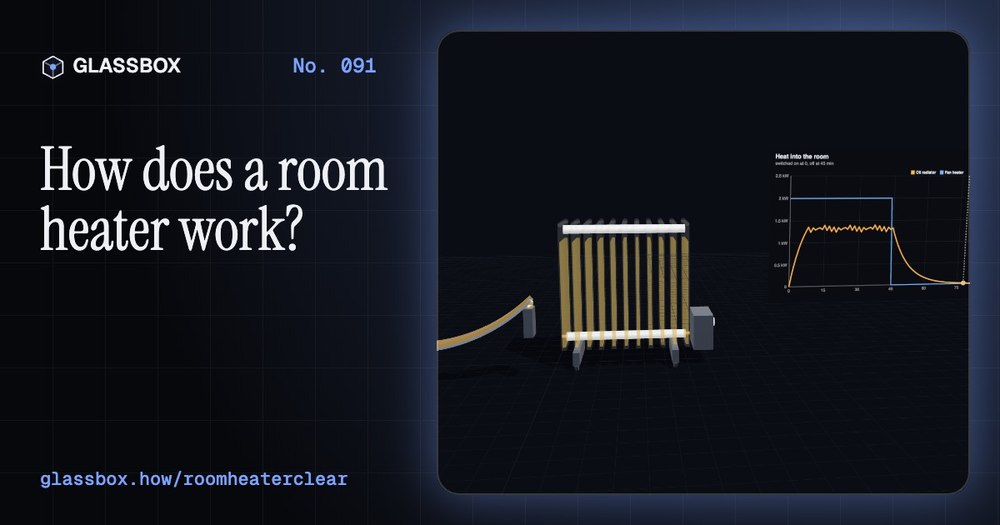
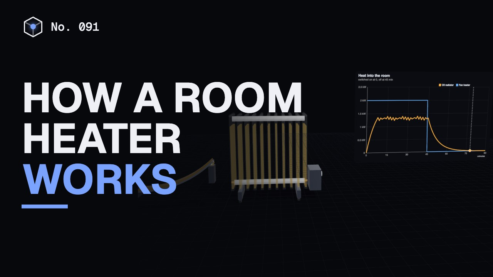
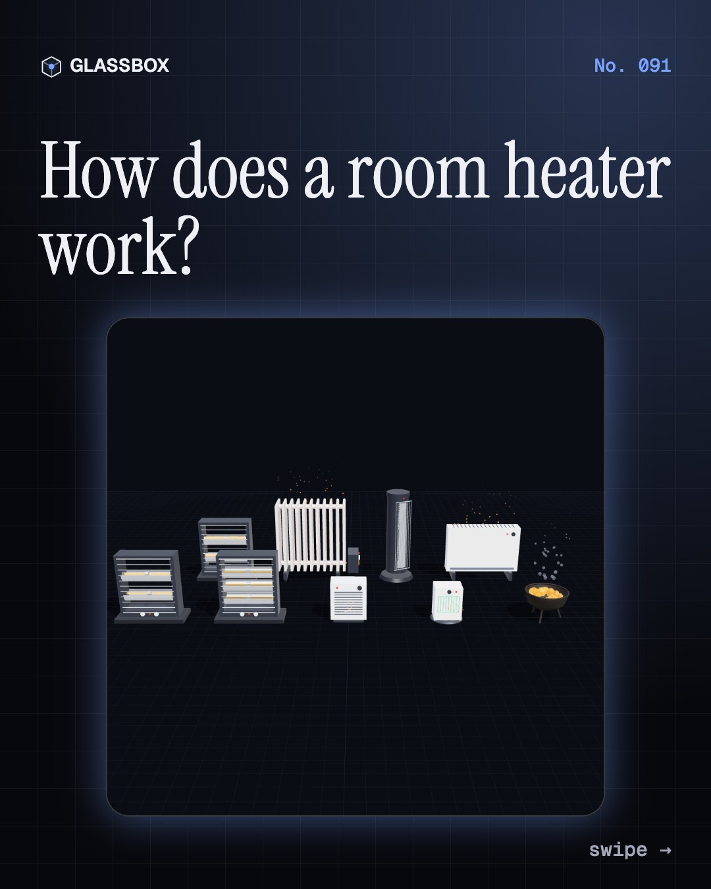
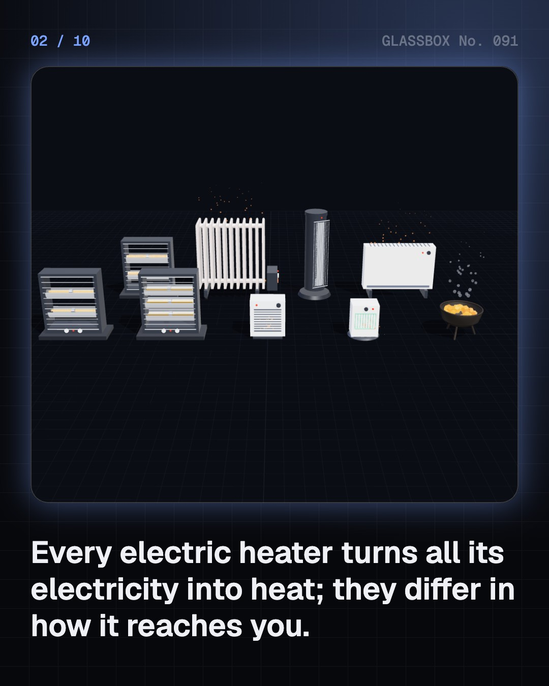
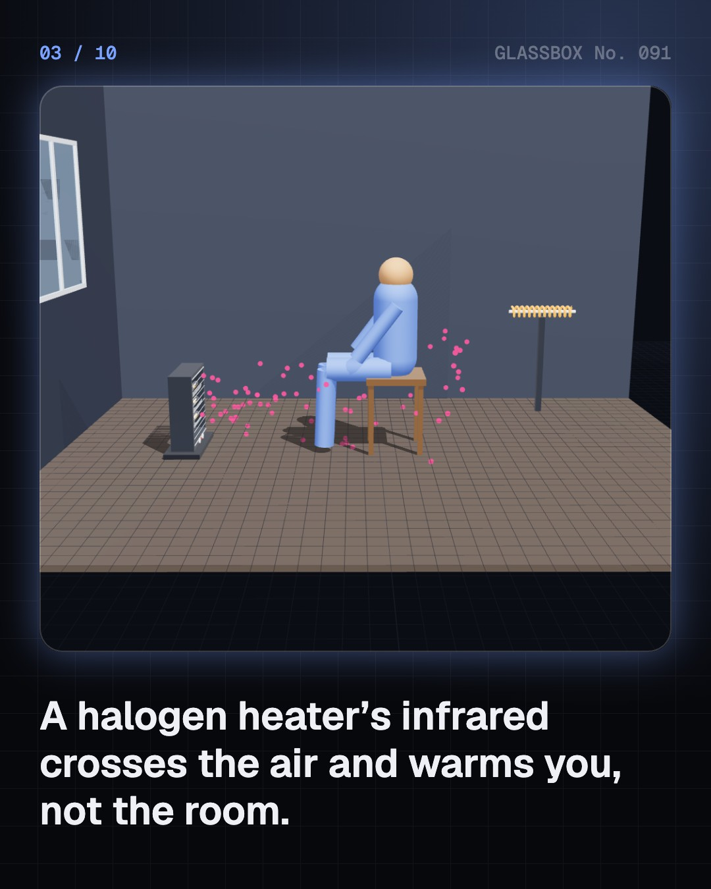
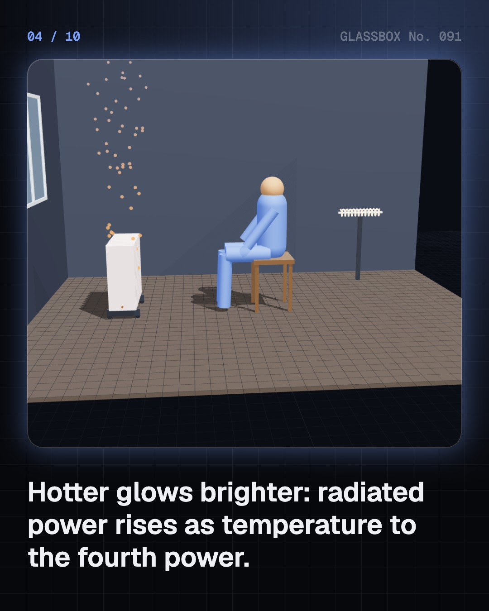

<!-- glassbox:start -->
<!-- Generated from glassbox.json by the Glassbox hub (npm run readme -- roomheaterclear). Edit glassbox.json, not this block. -->
<p align="center"><a href="https://glassbox.how/e/roomheaterclear/"></a></p>

<h1 align="center">RoomHeaterClear</h1>

<p align="center"><b>How does a room heater work?</b><br>Every electric heater turns 100% of its electricity into heat, yet a halogen warms your face in a second while an oil radiator needs many minutes to get going. Take nine heaters apart in 3D, heat a Delhi bedroom through a January night, and see why an angithi in a closed room can kill.</p>

<p align="center"><a href="https://glassbox.how/roomheaterclear/"><b>▶ Play with it</b></a> &nbsp;·&nbsp; <a href="https://glassbox.how/e/roomheaterclear/">Read the 60-second explainer</a> &nbsp;·&nbsp; <a href="https://glassbox.how/roomheaterclear/glassbox/reel.mp4">Watch the 40-second video</a></p>

<p align="center">
  <a href="https://glassbox.how/e/roomheaterclear/"></a>
  <a href="https://glassbox.how/e/roomheaterclear/"></a>
  <a href="LICENSE"></a>
  <a href="LICENSE-CONTENT.md"></a>
  <a href="#privacy"></a>
</p>

## In 60 seconds

1. **Every heater is 100% efficient.** A heater pushes current through a wire with resistance, and all of that electricity becomes heat: a 2,000 W heater on 230 V mains is about 26 Ω and makes 2 kWh of heat an hour. Heaters differ only in how the heat reaches you.
2. **Glow or flow.** Radiant heaters (rod, quartz, halogen, carbon) make something glow, and their infrared warms whatever it shines on, in seconds. Convection heaters (fan, PTC, convector, oil radiator) warm the air, which carries heat round the whole room, more slowly.
3. **Oil, bimetal and clever stones.** An oil-filled radiator stores over 10 kJ per degree in its oil and steel, so it warms slowly and stays warm. A bimetal strip bends to switch it off, a tip-over switch cuts it if it falls, and PTC ceramic stones raise their own resistance above about 220 °C so they can't overheat.
4. **A room is a leaky box.** A typical Indian bedroom leaks about 100 watts for every degree it is held above the outside air. On a 7.5 °C Delhi January night, a 2 kW fan heater warms the air in about an hour, but the brick walls take many hours, and eight hours flat out costs 16 units: over ₹100.
5. **Dry air and a silent gas.** Warming air adds no water, so humidity falls: foggy 85% outside becomes about 32% indoors at 22 °C. Burning charcoal, coal or wood in a closed room is far worse: odourless carbon monoxide builds up and can kill sleepers in two or three hours.
6. **Use it safely.** Keep a metre clear of curtains and beds, plug a 2 kW heater (8.7 A) into a 16 A wall socket rather than a thin extension board, switch off at bedtime, and buy one with the ISI mark. Never sleep beside an angithi.

## Words worth knowing

| Term | Meaning |
|---|---|
| **Resistance heating** | Current through a resistance turns electrical energy into heat: P = V²/R. All of it becomes heat. |
| **Infrared** | Light with wavelengths longer than red. Warm things give it off and we feel it as warmth. |
| **Stefan–Boltzmann law** | A surface radiates εσT⁴ watts per square metre with T in kelvin, so doubling the temperature gives 16 times the glow. |
| **Convection** | Heat carried by moving air or liquid: warm fluid rises, cool fluid sinks, and a fan pushes it harder. |
| **Thermal mass** | How much heat an object must take in to warm by one degree; big thermal mass means slow to heat and slow to cool. |
| **Bimetal thermostat** | A strip of two metals that bends as it warms and opens a contact at the set temperature. |
| **PTC ceramic** | A ceramic whose resistance rises steeply above a switching temperature, so it limits its own power. |
| **Relative humidity** | How much water vapour the air holds compared with the most it could hold at that temperature. |
| **Carbon monoxide** | A colourless, odourless gas from incomplete burning that stops the blood carrying oxygen. |

## A short history

**A million years from a fire in a cave to glowing halogen tubes, oil radiators, self-limiting ceramics and heat pumps, and the angithi that still kills in closed rooms.**

- **1000000 BCE** · Ash deep inside a cave (Early humans, probably Homo erectus, Wonderwerk Cave, Northern Cape)
- **80 BCE** · Fire under the floor (Sergius Orata (attributed), Campania, Roman Republic (today Italy))
- **1742** · Franklin's Pennsylvania fireplace (Benjamin Franklin, Philadelphia, British America)
- **1800** · Heat beyond the red (William Herschel, Slough, England)
- **1879** · Glow rises as temperature to the fourth power (Josef Stefan; Ludwig Boltzmann, Vienna, Austria-Hungary)
- **1906** · A wire that can glow for years (Albert Marsh, Illinois)
- **1912** · The fireclay electric fire (Charles Reginald Belling, Enfield, England)
- **1955** · A ceramic that limits itself (P. W. Haayman, R. Dam and H. A. Klasens (Philips), Eindhoven, Netherlands)

The full story, with 25 moments, charts, people and 29 sources: [glassbox.how/e/roomheaterclear/history](https://glassbox.how/e/roomheaterclear/history/). The data lives in [`history.json`](history.json).

## Video and slides

Made with the Glassbox studio from this box's storyboard (`window.glassbox.director`). Free to reuse under CC BY 4.0.

<a href="https://glassbox.how/roomheaterclear/glassbox/video.mp4"></a>

<p><a href="glassbox/slide-1.jpg"></a> <a href="glassbox/slide-2.jpg"></a> <a href="glassbox/slide-3.jpg"></a> <a href="glassbox/slide-4.jpg"></a></p>

| File | What | Size |
|---|---|---|
| [`glassbox/reel.mp4`](https://glassbox.how/roomheaterclear/glassbox/reel.mp4) | Reel / Short, with captions and soundtrack | 1080×1920 |
| [`glassbox/video.mp4`](https://glassbox.how/roomheaterclear/glassbox/video.mp4) | YouTube video, with captions and soundtrack | 1920×1080 |
| `glassbox/slide-1…10.jpg` | Instagram carousel | 1080×1350 |
| `glassbox/thumb.jpg` | YouTube thumbnail | 1280×720 |
| `glassbox/cover.jpg` | Share card and repo social preview | 1200×630 |
| [`glassbox/history-reel.mp4`](https://glassbox.how/roomheaterclear/glassbox/history-reel.mp4) | “History in 10 moments” Reel / Short | 1080×1920 |
| `glassbox/history-slide-*.jpg` | History carousel | 1080×1350 |
| `glassbox/post.json` | Post copy and schedule used by the publish kit | |

## Privacy

This box has no accounts and no ads, and it ships its own fonts and libraries. When you run it yourself it sends nothing anywhere. On glassbox.how, the site's `/bar.js` also loads Glassbox's analytics: **Google Analytics** to count visits (it asks first in the EU, UK and Switzerland, and stays off when your browser sends Global Privacy Control or Do Not Track) and **ClickTrust** to detect bots.

It remembers a few things **in your own browser only**, and never sends them anywhere:

| Browser storage key | What it holds |
|---|---|
| `roomheaterclear.v1` | Which chapters you have opened, your best quiz scores, and sound on or off. |

Exactly what each one sees is at [glassbox.how/privacy](https://glassbox.how/privacy/).

## Licences

- **Code:** [MIT](LICENSE). Use it, change it, ship it.
- **Explanations, text, images and videos** (`glassbox.json`, `glassbox/`): [CC BY 4.0](LICENSE-CONTENT.md). Credit “Glassbox, glassbox.how/e/roomheaterclear”.
- **Third-party parts** keep their own licences: [three.js](https://threejs.org) (MIT), [Geist, Instrument Serif](https://openfontlicense.org) (SIL OFL 1.1).
- The Glassbox name and logo aren't covered by either licence. See the [terms](https://glassbox.how/terms/).

Found a mistake? [Open an issue](https://github.com/bdeeps/roomheaterclear/issues). Corrections happen in public.
<!-- glassbox:end -->

## Run it

It's plain HTML, CSS and JavaScript. No build step and no dependencies. Run locally, it contacts no other website.

```bash
python3 -m http.server 8000
```

Three.js and the fonts ship in `vendor/` and `fonts/`, so it also works offline.

Then open http://localhost:8000.

## How it's built

| File | What |
|---|---|
| `index.html`, `css/app.css` | The page and its styles |
| `js/app.js`, `js/stage.js`, `js/ui.js`, `js/kit.js` | The shared Glassbox 3D engine: chapters, 3D stage, controls, quiz, video director |
| `js/chapters/*.js` | One file per chapter: the 3D model, controls, text, key terms, quiz and video scenes |
| `js/heater.js` | Shared physics and parts: glow colour and Stefan–Boltzmann radiation, the heater catalogue, the two-node room heat balance, PTC resistance, humidity, CO build-up and blood COHb (Coburn–Forster–Kane), chart boards and 3D builders for nine heaters |
| `glassbox.json` | Title, question, explainer beats, key terms, browser storage and credits shown on glassbox.how |
| `reel` in each chapter | The storyboard the Glassbox studio records into short videos |
| `glassbox/` | The published video, slides, thumbnail and post copy |
| `fonts/`, `vendor/three/` | Self-hosted Geist and Instrument Serif (SIL OFL 1.1) and three.js (MIT) |
